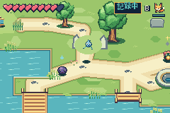
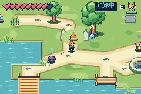
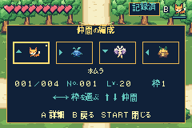
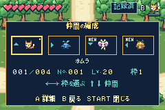
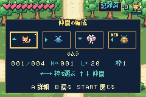

# Bell and post-boss companion discovery

The waiting Water creature occupied the basin bell's exact center. The bell is
now drawn independently at its original action coordinate (184,72), with the
waiting creature beside it at (216,72). The original bell approach remains
valid; approaching the creature directly also reaches its existing recruit
dialogue. Puzzle rules, rewards and entrances are unchanged.

Unobtained creatures already exposed by a region's recruitment flow now have
a stable gold marker above them. The automatically awarded Wind/Stone story
companions have compact NEW tags in both the L+direction selector and Party.
Fresh A inspection or committed L selection acknowledges the specific recruit.
Browsing or cancelling does not acknowledge it. The acknowledgement uses an
ordinary background save and survives Continue. No companion, EXP, quest or
reward is added by inspecting a marker.

Save5 content12 retains the 5088-byte payload and dual 6144-byte banks. Its
existing wallet reserve holds the two inspected-story bits and the separately
validated regional-purchase ledger. Revisions1..11 remain readable under their
prior policies; future extension bytes in a revision11 bank are rejected.

## Native comparison

| State | Before | After |
| --- | --- | --- |
| Basin bell with the waiting Water creature |  |  |
| Party after the original bosses |  |  |

These comparisons use controller-only branches from the review's authenticated,
empty-SRAM-earned original ending. The before images use unchanged main
cc5e88e. The after branch loads that unchanged content11 save into the content12
candidate, inspects Wind, cold Continues, and visits the basin. This is an
existing-save compatibility/visibility regression, not another fresh campaign.
Neither branch uses game-RAM writes or machine-state imports. Capture hashes and
source-save/ROM hashes are beside the images.

Separate fresh-cartridge checks pass: the first boss/shop/Fire trial/evolution
route (123 checks), and the original campaign followed by earned Water
recruitment, paired-pool trial, evolution and two-way shortcut (1396 regional
checks). Native presented-frame budgets are checked by those routes.

Host `tests/test_recruit_notice.py` checks acknowledgement ownership, source
proof, exact persistence, independent uninspected members, static badge bounds
and cumulative obtained-history world markers. The core economy codec tests
also reject false story inspection and revision11 extension forgery.
